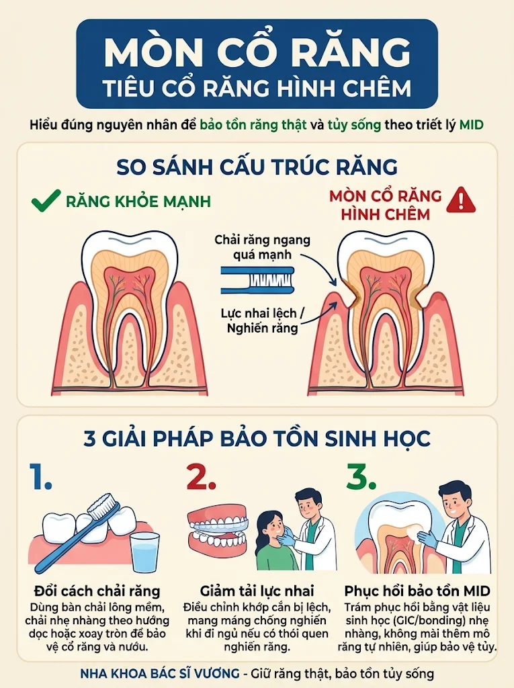
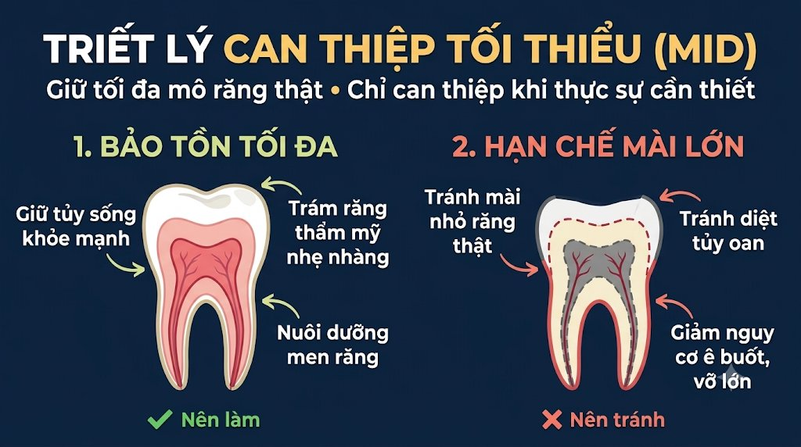

# Cách Chăm Sóc Răng Nhạy Cảm, Ê Buốt Cho Người Tuổi Trung Niên Theo Triết Lý MID: Hiểu Đúng Bản Chất Sinh Học Để Giữ Trọn Mô Răng Thật Và Tủy Sống

* **Tác giả:** Bác sĩ Trịnh Công Vương – Phòng khám Nha khoa Gia đình
* **Chuyên mục:** Giáo dục sức khỏe răng miệng & Bảo tồn răng thật theo triết lý MID (Nha khoa can thiệp tối thiểu)
* **Đối tượng:** Người tuổi trung niên (40–60 tuổi) & người cao tuổi
* **Mã bài viết (Slug):** `cham-soc-rang-nhay-cam-mid`

---

*Hình 1: Mòn cổ răng hình chêm và tụt lợi lộ ngà là nguyên nhân hàng đầu gây ê buốt răng ở tuổi trung niên.*

---

## 1. TIÊU ĐỀ

**Cách Chăm Sóc Răng Nhạy Cảm, Ê Buốt Cho Người Tuổi Trung Niên Theo Triết Lý MID: Hiểu Đúng Bản Chất Sinh Học Để Giữ Trọn Mô Răng Thật Và Tủy Sống**

---

## 2. VẤN ĐỀ: NỖI LO RĂNG Ê BUỐT TUỔI TRUNG NIÊN VÀ TÂM LÝ SỢ MÀI RĂNG, LẤY TỦY

Hơn 40 năm gắn bó với chiếc ghế nha khoa, lắng nghe và điều trị cho bà con, tôi gặp rất nhiều cô bác ở độ tuổi trung niên từ 40 đến 60 tìm đến phòng khám trong tâm trạng vừa mệt mỏi, vừa lo âu. Câu chuyện quen thuộc nhất mà cô bác thường tâm sự với tôi là:

> *"Bác sĩ Vương ơi, sao dạo này hàm răng của tôi nhạy cảm quá. Hễ uống một ngụm nước mát, ăn bát canh nóng, nếm chút đồ chua, đồ ngọt, thậm chí sáng sớm mở miệng hít luồng gió lạnh hay đưa bàn chải ngang qua sát viền lợi là một luồng ê buốt sắc nhọn chạy dọc lên tận óc!"*

Tình trạng răng nhạy cảm (**quá cảm ngà**) tuy không gây đau nhức âm ỉ suốt đêm như viêm tủy cấp, nhưng lại lấy đi niềm vui ẩm thực và sự thoải mái trong sinh hoạt hằng ngày. Nhiều cô bác vì sợ cảm giác nhói buốt bất chợt mà không dám ăn một múi bưởi, không dám uống cốc nước cam mát, lúc đánh răng cũng chỉ dám lướt qua loa khiến mảng bám lại càng tích tụ nhiều hơn.

Đáng trăn trở hơn cả là tâm lý hoang mang khi cô bác tự soi gương thấy sát viền lợi có những rãnh khuyết lõm vào như hình chữ V, hoặc thấy chân răng dài ra và ngả màu vàng sậm. Nghe lời truyền miệng hoặc đọc những thông tin quảng cáo tràn lan, không ít cô bác đinh ninh rằng răng mình đã bị "hỏng tủy", phải diệt tủy hàng loạt hoặc phải mài nhỏ cả hàm răng thật để bọc răng sứ thì mới chấm dứt được cơn ê buốt. Chính nỗi sợ tiếng mũi khoan mài răng và sợ mất đi tủy sống đã khiến nhiều người âm thầm chịu đựng suốt nhiều năm, để đến khi tổn thương ăn sâu sát buồng tủy hoặc gãy ngang thân răng thì việc cứu chữa đã trở nên phức tạp hơn rất nhiều.

> **🌿 Thông điệp cốt lõi từ Triết lý MID (Nha khoa can thiệp tối thiểu):**
> Đa số các trường hợp răng nhạy cảm, ê buốt ở tuổi trung niên hoàn toàn có thể kiểm soát và phục hồi êm dịu mà **KHÔNG cần lấy tủy, KHÔNG cần khoan mài mô răng lành hay bọc sứ xâm lấn.**

---

## 3. NGUYÊN NHÂN: CƠ CHẾ LỘ NGÀ VÀ 4 "THỦ PHẠM" THẦM LẶNG Ở TUỔI TRUNG NIÊN

Để chăm sóc và điều trị đúng gốc rễ, trước hết chúng ta cần hiểu rõ vì sao chiếc răng vốn cứng chắc lại trở nên nhạy cảm và ê buốt khi bước vào tuổi trung niên.

### Cơ chế sinh học: Khi "tấm áo giáp" biến mất và hệ thống ống ngà bị lộ

Cấu tạo của một chiếc răng khỏe mạnh gồm ba lớp rõ rệt:
* **Trong cùng:** Là **buồng tủy** chứa mạch máu và dây thần kinh cảm giác.
* **Ở giữa:** Bao quanh tủy là lớp **ngà răng**.
* **Ngoài cùng:** Ở phần thân răng là lớp **men răng** cứng chắc; ở phần chân răng là lớp **xê-măng** mỏng được lợi và xương ổ răng che phủ.

Điều đặc biệt nằm ở lớp ngà răng: Ngà răng không phải là một khối đặc kín mà chứa hàng vạn **ống ngà siêu nhỏ (micro-tubules)** chạy xuyên suốt từ bề mặt ngà vào thẳng buồng tủy. Bên trong mỗi ống ngà này chứa dịch ngà và các đầu tận cùng thần kinh. Khi lớp men răng bên ngoài bị mòn hoặc phần lợi bị tụt xuống, hàng vạn miệng ống ngà sẽ bị lộ thiên ra môi trường miệng.

Theo *Thuyết thủy động học (Hydrodynamic Theory)* trong y văn nha khoa, mỗi khi có tác nhân nóng, lạnh, chua, ngọt, luồng gió hoặc lông bàn chải chạm vào vùng ngà lộ, dòng dịch bên trong các ống ngà sẽ dịch chuyển đột ngột, tạo ra áp lực cơ học kích thích trực tiếp vào các sợi thần kinh trong buồng tủy và phát sinh luồng cảm giác nhói buốt như điện giật.

### 4 "Thủ phạm" gây lộ ngà ở độ tuổi 40–60

| STT | Nhóm nguyên nhân | Cơ chế gây tổn thương & biểu hiện lâm sàng |
| :-: | :--- | :--- |
| **1** | **Mòn cổ răng hình chêm (NCCL)** | Thói quen dùng bàn chải lông cứng, chải răng kéo ngang mạnh tay như "kéo cưa" qua vùng cổ răng kết hợp với lực nhai lệch hoặc lực uốn cơ học dồn xuống cổ răng qua hàng chục năm làm bong bật tinh thể men – ngà, tạo rãnh khuyết hình chữ V sắc nét sát viền lợi. |
| **2** | **Tụt lợi lộ ngà chân răng** | Cao răng và mảng bám dưới lợi gây viêm lợi, viêm nha chu mạn tính, cộng với tiêu xương sinh lý theo tuổi tác và thói quen xỉa răng bằng tăm tre làm lợi tụt xuống, bộc lộ lớp xê-măng mỏng và ngà chân răng mềm. |
| **3** | **Mòn men mặt nhai & Răng nứt ngầm** | Sau 40–50 năm ăn nhai, đặc biệt ở người có tật nghiến răng khi ngủ hoặc hay cắn đồ cứng (xương sụn, đá viên, hạt cứng), mặt nhai bị mòn phẳng lộ ngà vàng và xuất hiện các đường rạn nứt vi thể truyền kích thích thẳng vào tủy. |
| **4** | **Xói mòn axit & Chứng khô miệng** | Chế độ ăn nhiều đồ chua (chanh, cam, bưởi, dấm, nước có gas), trào ngược dạ dày - thực quản (GERD) hoặc giảm lưu lượng nước bọt do thuốc điều trị bệnh nền (huyết áp, tiểu đường) làm khử khoáng bề mặt và mở rộng miệng ống ngà. |

---

*Hình 2: Triết lý Nha khoa can thiệp tối thiểu (MID) ưu tiên bảo tồn tối đa mô răng thật và giữ trọn sự sống của tủy răng.*

---

## 4. GIẢI PHÁP: HỆ THỐNG CHĂM SÓC TẠI NHÀ VÀ CAN THIỆP TỐI THIỂU TẠI PHÒNG KHÁM THEO TRIẾT LÝ MID

Triết lý **Nha khoa can thiệp tối thiểu (MID)** đặt mục tiêu cao nhất là: **Bảo tồn tối đa mô răng thật, giữ trọn sự sống của tủy răng, ưu tiên tái khoáng hóa tự nhiên và sử dụng vật liệu tương hợp sinh học thay vì mài cắt cơ học.** Để giải quyết triệt để tình trạng răng nhạy cảm, ê buốt cho cô bác tuổi trung niên, phác đồ MID kết hợp chặt chẽ giữa việc thay đổi thói quen tại nhà và can thiệp bảo tồn nhẹ nhàng tại phòng khám.

### A. Giải pháp tự chăm sóc và bảo vệ sinh học tại nhà

1. **Đổi ngay sang bàn chải lông siêu mềm và thay đổi kỹ thuật chải răng:**
   * Cô bác hãy bỏ ngay bàn chải lông cứng và tuyệt đối chấm dứt động tác chải răng kéo ngang mạnh tay.
   * Hãy chọn bàn chải có đầu nhỏ, sợi lông siêu mềm (*Ultra Soft / Extra Soft*). Khi chải, đặt lông bàn chải nghiêng góc 45 độ về phía viền lợi, rung nhẹ tại chỗ rồi vuốt dọc theo chiều răng mọc (từ lợi về phía mặt nhai) hoặc xoay tròn nhẹ nhàng.
   * Thay thế hoàn toàn tăm tre bằng chỉ nha khoa, bàn chải kẽ răng hoặc máy tăm nước ở chế độ áp lực nhẹ để không làm tụt lợi thêm.

2. **Sử dụng kem đánh răng chuyên biệt chống ê buốt và tái khoáng hóa:**
   * Ưu tiên lựa chọn các dòng kem đánh răng dành riêng cho răng nhạy cảm có chứa **Fluoride** nồng độ phù hợp kết hợp với các hoạt chất sinh học giúp làm dịu thần kinh hoặc bít lấp miệng ống ngà như: *Potassium Nitrate (Kali Nitrat)*, *Stannous Fluoride (Thiếc Florua)*, *Arginine & Calcium Carbonate*, hoặc *Hydroxyapatite / Novamin*.
   * **💡 Mẹo nhỏ lâm sàng cho cô bác:** Với những vùng cổ răng đang ê buốt nhiều, trước khi đi ngủ (sau khi đã chải răng sạch), cô bác có thể lấy một lượng nhỏ kem đánh răng chống ê buốt trên đầu ngón tay sạch, thoa nhẹ trực tiếp lên vùng cổ răng bị lộ ngà và để yên khoảng 2–3 phút rồi mới nhổ bớt bọt (không cần súc miệng quá kỹ bằng nước) để các khoáng chất có thời gian lắng đọng, bít kín miệng ống ngà suốt đêm.

3. **Kiểm soát chế độ ăn axit, giữ ẩm khoang miệng và loại bỏ lực nhai quá tải:**
   * Hạn chế ăn đồ quá chua, quá lạnh hoặc quá cứng.
   * **⚠️ Lưu ý quan trọng:** **Sau khi ăn trái cây chua hoặc uống nước cam, chanh, cô bác tuyệt đối không đi đánh răng ngay lập tức** (vì lúc này axit đang làm mềm lớp men ngà, chải răng ngay sẽ làm mòn răng nhanh gấp nhiều lần). Hãy súc miệng kỹ bằng nước lọc hoặc nước muối sinh lý, đợi ít nhất 30 phút để nước bọt trung hòa axit rồi mới chải răng.
   * Uống đủ nước từng ngụm nhỏ trong ngày để khắc phục chứng khô miệng, giúp nước bọt phát huy vai trò "lá chắn tái khoáng" tự nhiên.

### B. Giải pháp can thiệp tối thiểu (MID) tại Phòng khám Nha khoa

Khi các rãnh mòn cổ răng đã hình thành rõ hoặc triệu chứng ê buốt kéo dài, cô bác cần đến phòng khám để bác sĩ thực hiện các biện pháp bảo tồn chuyên sâu:

1. **Bôi hoạt chất chống ê buốt chuyên sâu và Vecni Fluor (Fluoride Varnish):**
   Với các vùng lộ ngà chân răng mới chớm hoặc tụt lợi nhẹ chưa tạo thành rãnh khuyết sâu, bác sĩ hoàn toàn không cần dùng đến mũi khoan. Sau khi làm sạch mảng bám nhẹ nhàng bằng sóng siêu âm tinh tế, bác sĩ sẽ quét lớp **Vecni Fluor nồng độ cao** hoặc các **hoạt chất bít ống ngà sinh học (Desensitizing agents / Gluma / Sealant ngà)**. Các tinh thể canxi-fluoride và protein sẽ kết tủa ngay bên trong lòng ống ngà, tạo thành "nút chặn" sinh học giúp cắt đứt luồng dẫn truyền kích thích vào tủy ngay sau 1–2 lần thực hiện.

2. **Trám phục hồi sinh học bằng GIC độ nhớt cao hoặc vật liệu dán dính sinh học (Không khoan mài răng lành – Giữ trọn tủy sống):**
   Đối với các tổn thương mòn cổ răng hình chêm (NCCL) hoặc chớm sâu chân răng đã tạo thành rãnh khuyết chữ V:
   * Theo phương pháp cũ trước đây, người ta thường phải dùng mũi khoan tạo hình xoang trám làm mất thêm mô răng lành. Nhưng với **triết lý MID hiện đại**, bác sĩ chỉ cần làm sạch bề mặt ngà răng bằng dung dịch xử lý sinh học nhẹ nhàng, hoàn toàn **không khoan cắt mô răng lành**.
   * Sau đó, rãnh khuyết sẽ được đắp phục hồi bằng **vật liệu Glass Ionomer Cement thế hệ mới (GIC độ nhớt cao – HVGIC như Equia Forte)** hoặc **vật liệu dán dính sinh học (Bioactive / Composite dòng chảy kết hợp keo dán tự xói mòn êm dịu)**.
   * Điểm ưu việt tuyệt vời của GIC độ nhớt cao trong triết lý MID là khả năng **tự kết dính hóa học trực tiếp với ngà răng**, hệ số giãn nở nhiệt tương đồng với răng thật, không gây co ngót kích thích tủy, và đặc biệt là đóng vai trò như một **"kho dự trữ và giải phóng Fluoride"** liên tục vào mô ngà xung quanh. Nhờ đó, miếng trám vừa che chắn kín khít các ống ngà hở, vừa thúc đẩy ngà răng bên dưới tự tái khoáng hóa cứng chắc hơn, bảo vệ tủy sống an toàn tuyệt đối.

3. **Cân bằng khớp cắn và máng nhai bảo vệ ban đêm:**
   Bác sĩ sẽ kiểm tra toàn diện các điểm chạm khớp cắn để điều chỉnh nhẹ nhàng các điểm chạm sớm gây quá tải lực lên cổ răng. Nếu cô bác có tật nghiến răng khi ngủ, một chiếc **máng nhai mềm bảo vệ ban đêm** được thiết kế riêng cho khuôn hàm sẽ giúp phân tán lực nghiến, ngăn chặn triệt để tình trạng mòn mặt nhai, nứt răng ngầm và bong bật miếng trám cổ răng.

---

## 5. LỜI KHUYÊN ĐẶT LỊCH: LỜI NHẮN NHỦ TỪ BÁC SĨ TRỊNH CÔNG VƯƠNG

Cô bác và anh chị thân mến,

Trải qua hơn 4 thập kỷ làm nghề y, tôi luôn tâm niệm rằng: **Không có bất kỳ vật liệu nhân tạo hay chiếc răng sứ đắt tiền nào có thể quý giá và hoàn hảo bằng chính chiếc răng thật còn nguyên tủy sống mà tạo hóa đã ban tặng cho chúng ta.** Một chiếc răng còn tủy sống là một cơ thể sống biết cảm nhận lực nhai, có khả năng tự nuôi dưỡng và tự bảo vệ trước vi khuẩn.

Vì vậy, khi thấy răng mình có dấu hiệu nhạy cảm, ê buốt lúc ăn uống hay chải răng, cô bác đừng âm thầm chịu đựng, nhưng cũng đừng vội hoang mang nghĩ đến việc phải lấy tủy hay mài nhỏ răng để bọc sứ. Hãy đi thăm khám sớm khi tổn thương còn ở giai đoạn nhẹ. Chỉ cần một buổi trò chuyện, kiểm tra kỹ lưỡng dưới ánh sáng lâm sàng, điều chỉnh lại cách chải răng và phủ một lớp vật liệu sinh học nhẹ nhàng theo triết lý Nha khoa can thiệp tối thiểu (MID), cô bác sẽ lấy lại ngay cảm giác êm ái, thoải mái thưởng thức những món ăn yêu thích cùng gia đình với hàm răng thật khỏe mạnh suốt tuổi xế chiều.

Nếu cô bác đang gặp phiền toái vì những cơn ê buốt răng hay cần một lời khuyên chân thành, chuẩn mực y khoa để bảo tồn hàm răng của mình, xin mời cô bác ghé thăm phòng khám hoặc liên hệ trực tiếp với tôi để được tư vấn và đặt lịch khám chu đáo nhất:

* **Phòng khám Nha khoa Gia đình – Bác sĩ Trịnh Công Vương**
* **Địa chỉ:** Số 15 đường Võ Nguyên Giáp, phường Đức Xuân, tỉnh Thái Nguyên
* **Điện thoại & Zalo tư vấn trực tiếp:** **0912 343 858**
* **Website chính thức:** [https://bsvuong.life](https://bsvuong.life)

*Chúc các cô bác, anh chị luôn giữ mãi nụ cười khỏe mạnh, bình an và trọn vẹn niềm vui trong cuộc sống!*
